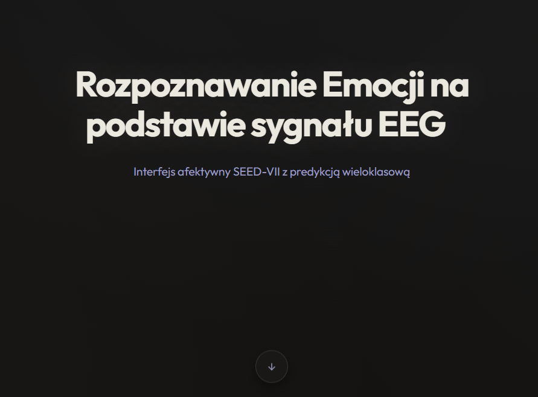
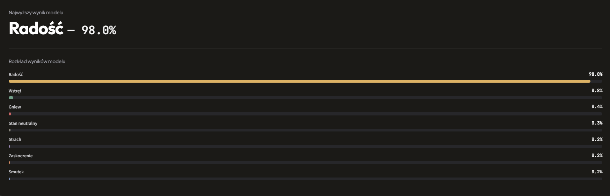
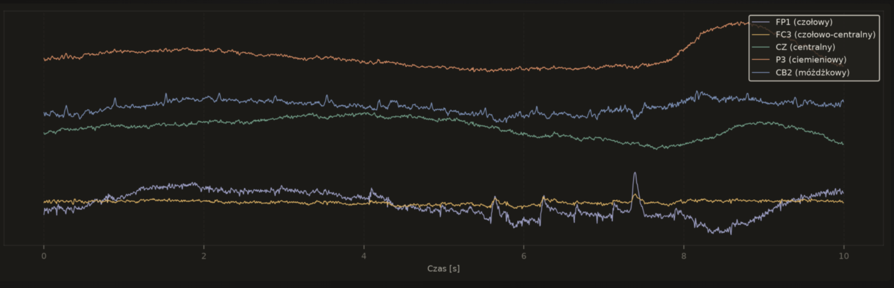

# Aplikacja webowa do analizy EEG i klasyfikacji emocji

Projekt licencjacki **Dominika Zaręby**, zrealizowany na Uniwersytecie Marii Curie-Skłodowskiej w Lublinie w 2026 roku pod kierunkiem dr. inż. Piotra Schneidera.

Aplikacja łączy przetwarzanie sygnałów EEG, własną ekstrakcję cech, klasyczne modele uczenia maszynowego oraz interfejs webowy do analizy i prezentacji wyników. Projekt powstał na zbiorze **SEED-VII** i obejmuje klasyfikację do siedmiu klas emocji.

**[Pełna praca licencjacka — PDF](docs/Praca_licencjacka_Dominik_Zareba.pdf)** · **[Oryginalna paczka aplikacji dołączona do pracy — ZIP](docs/Aplikacja_EEG.zip)**

## Podgląd aplikacji







*Zrzuty pochodzą z pracy licencjackiej, z części opisującej interfejs aplikacji.*

## Funkcje

- Wczytywanie plików MATLAB `.mat` z sygnałami EEG lub gotowymi cechami.
- Wybór próby w plikach zawierających wiele rejestracji.
- Walidacja formatu danych, wymiarów, częstotliwości próbkowania i kolejności kanałów.
- Ekstrakcja entropii różniczkowej (DE) w pięciu pasmach oraz wygładzanie LDS.
- Klasyfikacja siedmiu emocji i prezentacja wyników dla wszystkich klas.
- Wizualizacja sygnałów oraz mapy cech.
- Wybór zakresu czasu, eksport fragmentów danych i raportu PDF.
- Porównywanie modeli SVM, Random Forest i XGBoost w kilku schematach walidacji.

## Przetwarzanie i modelowanie

Przy własnej ekstrakcji sygnał jest dzielony na czterosekundowe okna. Dla **62 kanałów** obliczane są cechy DE w **5 pasmach**, a sekwencje cech są wygładzane z użyciem LDS. Agregacja po oknach daje wektor **310 cech** na próbę.

Aplikacja rozróżnia sygnał i gotowe cechy oraz dobiera odpowiedni artefakt modelu. Dla sygnałów wejściowych wymagane jest **200 Hz** i układ kanałów zgodny z SEED-VII; nie jest to uniwersalny importer dowolnego zapisu EEG.

## Wyniki opisane w pracy

| Protokół | Model, cechy własne | Accuracy | Macro-F1 |
| --- | --- | ---: | ---: |
| Subject-dependent (SD) | SVM | 42,06% | 0,4097 |
| Leave-one-subject-out (LOSO) | XGBoost | 24,25% | 0,2371 |
| Stimulus-independent (SI) | SVM | 39,62% | 0,3797 |

Są to wyniki różnych protokołów, a nie zamienne miary skuteczności. LOSO sprawdza generalizację na osobę nieobecną w treningu. W pracy oceniono również macierze pomyłek, przedziały ufności oraz metryki probabilistyczne i kalibrację. Wartości `predict_proba` nie należy utożsamiać z potwierdzoną trafnością predykcji.

Projekt jest **prototypem badawczym**, a uzyskane wyniki nie stanowią podstawy do zastosowań diagnostycznych.

## Uruchomienie aplikacji

W katalogu projektu utwórz środowisko Python i zainstaluj zależności:

```bash
python -m venv .venv
# Linux / macOS:
source .venv/bin/activate
# Windows PowerShell zamiast powyższego polecenia:
# .venv\Scripts\Activate.ps1
python -m pip install -r requirements.txt
python -m streamlit run app/streamlit_app.py
```

Modele są oczekiwane w `ml/models/best_model.joblib` i `ml/models/best_model_own_features.joblib`. Gotowe modele wymagają środowiska zgodnego z wersjami użytymi przy ich zapisie; w razie niezgodności zależności należy odtworzyć środowisko lub ponownie wytrenować modele.

Do analizy potrzebny jest zgodny plik `.mat`. Dane SEED-VII nie są dołączone do repozytorium. Dostęp do nich wymaga osobnego uzyskania uprawnień od autorów zbioru.

## Odtworzenie przygotowania danych i treningu

Umieść katalogi `EEG_features` i `EEG_preprocessed` w katalogu projektu albo wskaż katalog bazowy zmienną `SEED_VII_DATA_DIR`.

```bash
# Referencyjne cechy udostępnione z SEED-VII:
python -m ml.build_dataset --source features
python -m ml.train --scheme both --features reference

# Cechy obliczone własnym ekstraktorem z sygnału:
python -m ml.build_dataset --source preprocessed
python -m ml.train --scheme both --features own
```

Parametry ekstrakcji, etykiety, kanały i ścieżki opisuje `ml/config.py`. Metryki oraz wykresy są zapisywane w `reports/`.

## Struktura

| Katalog / plik | Zawartość |
| --- | --- |
| `app/` | Interfejs Streamlit, wczytywanie danych, predykcja i raport PDF |
| `ml/` | Konfiguracja, ekstrakcja cech, budowa zbioru, trening i metadane modeli |
| `ml/models/` | Zapisane artefakty modeli |
| `tests/` | Testy funkcji aplikacji, przetwarzania danych i wyboru modeli |
| `docs/` | Praca licencjacka, paczka złożonej aplikacji i zrzuty interfejsu |

Kod w głównych katalogach jest wersją rozwijaną w repozytorium. Archiwum `docs/Aplikacja_EEG.zip` zachowuje oryginalną paczkę przekazaną wraz z pracą, w tym jej testy; wersje nie muszą być identyczne. Archiwum nie zawiera zbioru SEED-VII ani wytrenowanych modeli.

## Testy

```bash
python -m pip install -r requirements-dev.txt
python -m pytest -q tests
```

Testy obejmują m.in. walidację danych `.mat`, ekstrakcję cech, rozdzielanie danych w walidacji i wybór modelu. Test wymagający gotowego artefaktu jest pomijany, jeśli plik modelu nie jest dostępny.

## Zakres mojej pracy

Przygotowanie aplikacji i interfejsu, implementacja ekstrakcji cech i przetwarzania danych, trening i porównanie modeli, opracowanie walidacji i metryk, wizualizacje, raportowanie oraz przygotowanie pracy licencjackiej.

## Technologie

Python, Streamlit, NumPy, SciPy, pandas, scikit-learn, XGBoost, joblib i matplotlib.
